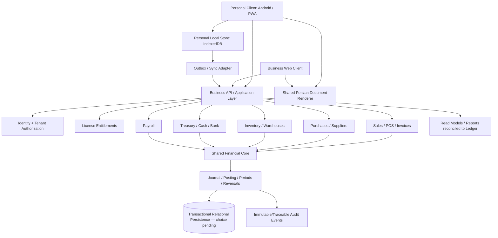

# معماری هدف Hesabyar 2.0 — پیشنهاد بر پایهٔ ممیزی `KarenYar`

**وضعیت:** پیشنهاد مرحلهٔ معماری؛ نیازمند تأیید مالک و بررسی constraints است.
**تاریخ:** 2026-11-04
**مبنای وضعیت فعلی:** `rahmaniho/KarenYar/main`، commit `d41ca2916a4edfa93b5edbeeefa6403d11a3ff24`.

## 1. جمع‌بندی معماری

سورس موجود یک برنامهٔ React/Vite/Capacitor آفلاین‌فرست با Dexie/IndexedDB محلی است. قابلیت فروشگاه و امور شخصی در یک برنامه/DB ترکیب شده‌اند. API مالی مرکزی، دفترکل دوطرفه، RBAC، tenant یا sync مالی وجود ندارد. بنابراین Hesabyar 2.0 نباید با بازنویسی یک‌مرحله‌ای همین برنامه شروع شود.

**جهت‌گیری هدف پیشنهادی:**

- یک Shared Financial Core با قواعد پول، posting، دفترکل، دوره و reversal.
- یک backend چندماژوله به سبک **modular monolith** برای عملیات Business و ledger؛ نه microservices پیش‌فرض.
- دو تجربهٔ Personal و Business با entitlementهای صریح؛ محاسبات/ثبت مالی مشترک.
- Personal می‌تواند local-first/offline بماند؛ Business برای multi-user باید server-authoritative باشد و offline را با queue/commandهای idempotent و conflict workflow محدود پشتیبانی کند.
- client فعلی مرحله‌به‌مرحله مهاجرت کند و همچنان backup/import و قابلیت‌های سالمش حفظ شود.

این‌ها تصمیم‌های پیشنهادی‌اند؛ DB/backend hosting و مدل sync تا بررسی محدودیت‌های تجاری/عملیاتی نهایی نیستند.

## 2. نمای هدف مفهومی

- نمودار target است؛ endpoint، table یا infrastructure فعلی محسوب نمی‌شود.
- Personal offline store می‌تواند موقتاً local باقی بماند؛ همگام‌سازی فقط پس از مدل‌سازی عملیات/تعارض.
- Report read models باید از journal/ledger معتبر مشتق و با آن reconcile شوند.

## 3. لایه‌ها و قواعد وابستگی

1. **Clients:** React/Vite/Capacitor فعلی به‌تدریج اصلاح؛ UI منطق ledger یا license signing ندارد.
2. **Application services:** use-caseهایی مثل IssueInvoice, RecordPayment, PostPurchase, Void/ReverseTransaction؛ authorization و idempotency در مرز مورداعتماد.
3. **Domain modules:** Shared Money/Accounting Core و moduleهای فروش، خرید، موجودی، خزانه‌داری و payroll.
4. **Persistence adapters:** Dexie برای Personal/آفلاین؛ adapter سروری برای Business. نوع DB مرکزی هنوز انتخاب نشده است.
5. **Infrastructure:** auth provider، license service، storage، logging، backup و release؛ secrets فقط server-side.

اگر backend آینده با TypeScript باشد، استفاده از package دامنهٔ مشترک می‌تواند قواعد را در client/server یکسان کند. اگر backend دیگری انتخاب شود، canonical test vectors و conformance tests بین زبان‌ها الزامی‌اند؛ دو پیاده‌سازی بدون آزمون مشترک مجاز نیستند.

## 4. قابلیت‌های مالیِ هسته

- Money/Quantity با currency و unit صریح، exact decimal semantics و policy گردکردن.
- Chart of Accounts، JournalEntry و JournalLine، period controls و posting state.
- Atomic balanced posting: مجموع debit و credit برابر، و خطای جزئی بدون state نیمه‌کاره.
- Idempotency برای درخواست/command و outboxهای sync.
- Posted records immutable؛ correction با reversal/adjustment قابل ردیابی.
- Source reference از invoice/payment/stock movement تا ledger.
- Audit event مستقل از UI و گزارش‌های reconciled.

`src/core/currency/money.ts` و `src/features/store/invoice-calc.ts` نقطهٔ شروع قابل استفاده‌اند؛ اما آن‌ها ledger یا accounting engine کامل نیستند.

## 5. Shared Core و editionها

### Shared

- money/currency/unit، rounding، tax policy framework؛
- financial transaction identity، posting/reversal، period validation؛
- منطق مشترک invoice/payment و mapping به ledger؛
- audit/tracing و document data contract.

### Personal

- UX ساده، single owner و قابلیت local/offline در صورت حفظ امنیت؛
- درآمد/هزینه، بودجه/بدهی و فروش روزمره؛
- migration/backup روشن؛ عدم قفل‌کردن داده به‌خاطر license.

### Business

- multi-company/users/roles و backend enforcement؛
- full double-entry، خرید/AP، خزانه‌داری، چندانبار و reports رسمی؛
- approval/period close و APIها.

هیچ محاسبهٔ مالی مشترک نباید به‌علت edition تکرار شود. Feature visibility در UI فقط UX است؛ entitlements و authorization جداگانه enforce شوند.

## 6. مدل تراکنش‌ها

- فروش باید invoice، stock movement و journal posting را atomic یا با command/outbox قابل reconciliation ثبت کند.
- خرید/پرداخت/برگشت باید نیز به ledger و موجودی متصل شوند.
- cash sale باید receipt/cash movement صریح داشته باشد؛ صرفاً یک method string کافی نیست.
- void فعلی که income transaction را delete می‌کند، پیش از اتکای Business به مدل reversal تبدیل شود.
- آفلاین Business فقط commandهای مجاز/قابل retry را محلی queue کند؛ journal posted با last-write-wins همگام نشود.

## 7. انتخاب‌های باز

- backend runtime و relational database مرکزی.
- identity provider و مدل سازمان/شرکت/شعبه.
- scope دقیق offline برای Business و سطح eventual consistency.
- canonical currency/unit، policy tax و تاییدکنندهٔ مقررات ایران.
- نگهداری/انقضای licenseهای فعلی و مسیر مهاجرت KS1 به سرور.
- نسخهٔ کمینهٔ Business و سازگاری مشتریان فعلی.

پیش از تصویب، این‌ها باید در TDRها تکمیل شوند.
