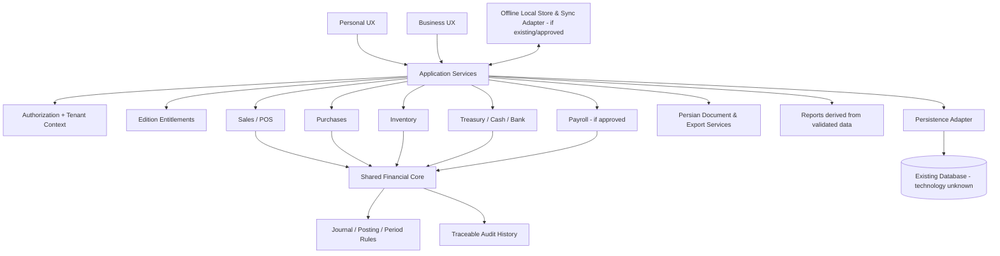

# پیشنهاد مقدماتی معماری هدف — Shared Core

> **یادداشت به‌روزرسانی:** این نسخه پیش از شناسایی سورس `rahmaniho/KarenYar` نوشته شده بود. source فعلی اکنون در `docs/audit/APP_CODE_AUDIT.md` ممیزی شده و معماری پیشنهادی مرحلهٔ بعد در [`docs/architecture/`](../architecture/README.md) قرار دارد. متن زیر فقط پیشنهاد مقدماتی اولیه است؛ اسناد معماری جدید مرجع این مرحله‌اند.

**وضعیت:** `HISTORICAL PRELIMINARY / NOT APPROVED`
**تاریخ:** 2026-11-04
**محدودیت اولیه:** این سند پیش از دسترسی به source برنامه تهیه شد؛ جهت‌گیری دامنه‌ای است، نه نقشه اجرایی یا migration مصوب.

## 1. اصول هدف

1. یک هسته مالی مرجع برای Personal و Business؛ قواعد محاسبه و posting کپی نشوند.
2. ماژول‌های عملیاتی از سرویس‌های مالی مجاز استفاده کنند؛ UI یا template مستقیماً مانده/ledger را تغییر ندهد.
3. نسخه محصول (edition/entitlement)، مجوز کاربر (authorization) و مرز شرکت (tenant) سه مفهوم مستقل باشند.
4. تراکنش مالی posted حذف یا بی‌ردپا بازنویسی نشود؛ هر اصلاح به اصل رویداد قابل ردیابی باشد.
5. عملیات وابسته فروش/انبار/حسابداری باید atomic یا دارای سازوکار جبرانی صریح و آزموده‌شده باشند.
6. offline synchronization نباید تراکنش مالی را با last-write-wins خام جایگزین کند.
7. Modular monolith گزینه پیش‌فرض بررسی است، نه تصمیم قطعی؛ معماری فعلی باید اول کشف شود.

## 2. نمودار مفهومی پیشنهادی (technology-agnostic)

نمودار رابطه هدف‌محور را نشان می‌دهد؛ هیچ جزء آن به‌عنوان implementation فعلی ادعا نمی‌شود.

## 3. مرزهای دامنه پیشنهادی

| حوزه | مسئولیت مفهومی | مرز/قاعده |
|---|---|---|
| Shared Financial Core | Money/currency/unit semantics، journal posting، period guard، reversal، accounting validation | تنها مرجع قواعد و ثبت‌های مالی؛ خارج از UI |
| Sales/POS | فاکتور، تخفیف/مالیاتِ مصوب، برگشت و وضعیت فروش | اثر مالی/موجودی را از سرویس‌های مرکزی درخواست کند |
| Purchases | خرید، تأمین‌کننده، پرداخت/برگشت | مستقیم balance/ledger را دستکاری نکند |
| Inventory | stock movement، warehouse و valuation مصوب | حرکت موجودی و سند حسابداری قابل تطبیق باشد |
| Treasury | صندوق/بانک/چک/مغایرت | ثبت دریافت/پرداخت در مرز تراکنشی مشخص |
| Reporting | گزارش عملیاتی و مالی | گزارش‌های رسمی از ledger معتبر مشتق شوند |
| Documents | PDF/چاپ/Excel/CSV و RTL | داده معتبر را نمایش دهد؛ منطق مالی مستقل نداشته باشد |
| Entitlements | قابلیت‌های مجاز edition/license | backend enforcement؛ حفظ licenseهای معتبر جاری |
| Identity/Authorization | کاربر، نقش، شرکت و دسترسی | از edition entitlement جدا؛ tenant scoping در backend |
| Offline/Sync | ذخیره محلی، queue، replay و conflict | فقط پس از audit؛ بدون overwrite خام تراکنش posted |

مرزبندی فوق باید با ماژول‌های واقعی، DB و سازوکارهای فعلی تطبیق داده شود و ممکن است اصلاح شود.

## 4. مرز Personal و Business

- Personal و Business دو تجربه/سطح قابلیت بر یک هسته‌اند، نه دو implementation مالی.
- Personal می‌تواند workflow و گزارش ساده‌تری ارائه کند؛ Business capabilityهای حسابداری، چندکاربره و چندانباره را پس از تأیید فراهم می‌کند.
- پنهان‌کردن منو به‌تنهایی مجوزدهی نیست؛ enforcement باید در لایه مورداعتماد backend باشد.
- هر تغییر entitlement باید با licenseهای موجود سازگار باشد و خطای مجوز نباید داده مالی را تخریب/قفل کند.
- فهرست قابلیت‌های هدف نیازمند تصدیق Product/Owner و مقایسه با محصول موجود است.

## 5. قواعد تراکنش و داده

- هر posting باید شناسه پایدار، منبع/مرجع و وضعیت مشخص داشته باشد.
- مبلغ، ارز، واحد، مقیاس اعشار و rounding policy باید صریح باشند.
- سند posted متوازن باشد؛ duplicate/retry posting دوم نسازد.
- خطای میانه عملیات نباید موجودی یا accounting partial باقی بگذارد.
- correction/reversal سابقه اصلی را حفظ کند.
- گزارش مالی باید با underlying ledger reconcile شود.
- transactional outbox یا pattern خاصی پیشنهاد قطعی نمی‌شود؛ انتخاب آن وابسته به DB/معماری واقعی است.

## 6. راهبرد مهاجرت داده (گیت‌های مقدماتی)

1. **Discover:** تأیید source، نوع DB، schema، migration history، مالکیت داده و write paths.
2. **Baseline:** backup غیرتولیدی و restore آزمایش‌شده؛ ثبت شمار رکوردها، مانده حساب‌ها، موجودی و totals.
3. **Map:** تعریف mapping legacy→هدف، قواعد تبدیل ارز/اعشار/شناسه، سوابقی که immutable می‌مانند و مواردی که نیازمند reconciliation هستند.
4. **Rehearse:** اجرای migration/import روی copy؛ idempotency، زمان اجرا، lockها و rollback بررسی شود.
5. **Validate:** مقایسه record counts، referential integrity، مانده‌ها، journal totals و چند نمونه trace از منبع تا گزارش.
6. **Approve:** مالک محصول، accounting domain owner، DB/Security و QA نتایج و rollback را تأیید کنند.
7. **Cut over:** فقط با approval جداگانه و برنامه توقف/بازگشت؛ داده قدیمی حذف نشود.
8. **Observe:** reconciliation پس از انتقال؛ legacy تا پذیرش نهایی read-only/قابل بازیابی بماند، اگر طرح فنی اجازه دهد.

این مراحل migration واقعی نیستند؛ جزئیات online/offline، dual-write و cutover تا شناخت فناوری تعیین نمی‌شوند.

## 7. وابستگی‌ها و تصمیم‌های باز

- سورس صحیح و framework/runtime.
- DB/schema و transaction guarantees.
- مدل چندشرکتی/شعبه و قراردادهای مجوز موجود.
- قواعد مالی/مالیاتی بازار هدف و مسئول انسانی تأییدکننده.
- دامنه واقعی offline و رفتار داده‌های posted.
- نیازهای حجم/کارایی و محیط deployment.
- سازگاری عقب‌رو و نقاط rollback.

## 8. گیت approval

قبل از تصویب معماری نهایی باید M0/M1 روی سورس صحیح کامل شوند. این سند مجوز بازنویسی، migration، تغییر policy مجوز یا ایجاد سرویس جدید نیست. پس از دریافت کد و تأیید گزارش ممیزی، سندهای رسمی `docs/architecture/` با شواهد، ADR و ساختار واقعی تکمیل خواهند شد.
